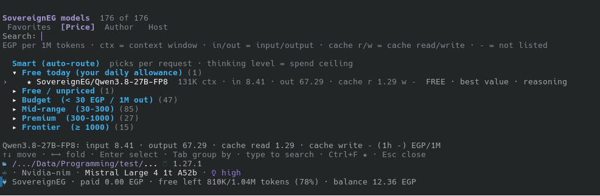

# pi-sovereigneg

[](https://github.com/GreenVenom77/pi-sovereigneg/releases)
[](https://github.com/GreenVenom77/pi-sovereigneg/actions/workflows/ci.yml)
[](LICENSE)

Use [SovereignEG](https://sovereigneg.com) (Egyptian, EGP-billed AI model routing) as a first-class provider in the
[pi coding agent](https://pi.dev): one-step sign-in, smart per-request model routing, a collapsible model picker,
and live free/paid usage in your footer.

> ## ⚠️ Disclaimer: this extension is fully vibe-coded
>
> This project was written **entirely with AI assistance ("vibe coding")**: generated by an AI assistant from
> prompts and docs, and **not** hand-written or audited line by line by a human expert.
>
> - It has an automated test suite (against a *fake* pi and a *fake* SovereignEG API, plus fixtures captured from a
>   real Student-plan account), but it has had **limited testing against the real services**. Some pi behaviours
>   were inferred from documentation. See [Known limitations](#known-limitations).
> - It handles your **API key** and your **money** (EGP credit). Please read the source, which is short, before you
>   install it, and start with a small balance.
> - Costs and allowance figures shown by the extension are **estimates** until the server confirms them. Your
>   SovereignEG dashboard is the source of truth.
> - **Unofficial.** Not affiliated with, endorsed by, or supported by SovereignEG or the pi project.
> - Provided "as is", without warranty of any kind ([MIT](LICENSE)). Use at your own risk.
>
> Bug reports and pull requests are very welcome.

---

## Contents
[Screenshots](#screenshots) · [Features](#features) · [Install](#install) · [Quick start](#quick-start) · [Commands](#commands) ·
[Model picker](#model-picker-sm) · [Smart routing](#smart-routing) · [Live usage](#live-usage) ·
[Configuration](#configuration) · [Privacy & security](#privacy--security) · [Troubleshooting](#troubleshooting) ·
[Known limitations](#known-limitations) · [Development](#development)

## Screenshots

### `/sm` model picker



### Footer

![The footer: current model with [FREE]/[PAID], paid and free-used totals, free allowance left, balance and subagent](.assets/footer.png)

## Features

**Sign-in**
- `/login` → **SovereignEG** points you to the dashboard key page (pi opens or displays the link), you paste the
  `sk-…` key, and it is **validated against the API before it is stored** (bad or revoked keys are rejected immediately, with a clear message).
- Or just set `SOVEREIGNEG_API_KEY`.
- SovereignEG doesn't offer OAuth / device login today, so this is as close to one-click as an API-key service gets.

**Models**
- **The provider's API is the only source of truth.** Models and prices come from `GET /v1/models`; no model or price
  is hard-coded in the extension. The list is re-read when pi starts and every time you open `/sm`, and the last answer
  is cached on disk, so pi starts instantly and you can still browse the models (and their last known prices) offline.
- Prices shown in **EGP per 1M tokens** (including the real prompt-cache read/write prices), with context window,
  tool-calling and reasoning support.
- **Health & deprecation aware**: models whose backends are all down, or that SovereignEG has deprecated, are
  badged (`DOWN`, `deprecated`) and never auto-routed.
- **Quality floor**: tiny models (≤3B parameters) and models with less than 32K context are never auto-routed or
  recommended, even if they claim tool support.
- Models are grouped by their real **author** (`provider`, e.g. Alibaba, Anthropic), not by who hosts them, except
  models SovereignEG brands as its own (`SovereignEG/…`), which are grouped under **SovereignEG** (like the smart router).
- **`/sm` model tree**: collapsible groups, switch tabs with `Tab` (Favorites / Price / Author / Host),
  live search, favorites. See [Model picker](#model-picker-sm).
- **Short `/model` list**: pi's own `/model` shows `sovereigneg/smart` plus your **favorites**, your **recent** models
  (the last 8, newest = the selected one), **today's free-allowance models** (read from `/v1/credits`, not a built-in
  list) and anything matching `pinned`; everything else is one `/sm` away.

**Smart routing** (`sovereigneg/smart`)
- A virtual model that picks the right real model **for each request**: cheap for easy tasks, strong for hard ones.
- **The thinking level is a spend ceiling** (`low` economy · `medium` balanced · `high` may use top models).
- Prefers your **free daily allowance** (Student / Developer Pack) while it lasts, and stops using it the moment
  it runs out.
- Keeps one model through tool-call loops (preserves prompt cache). **Errors never switch the model**: pi retries on
  the same one and you decide whether to switch (`/model` or `/sm`).
- Picks from the models the API lists, **by price** (no model names built in); you can steer it with `tiers`.
- See [Smart routing](#smart-routing).

**Cost & usage**
- **Live footer**: current model tagged `[FREE]` or `[PAID]`, session spend in EGP, free allowance left
  (in tokens, and %), and your balance if the API reports it, **updating while the reply streams**, not only after the turn.
  Compact layout for narrow terminals and an opt-in requests-per-minute counter. Session totals survive `/reload`,
  `/resume` and restarts.
- **Hidden-thinking guard**: some models think (and bill for it) by default when no reasoning effort is sent, without
  ever showing that thinking. For models the API data marks that way (a reasoning model that doesn't list
  `include_reasoning` and accepts `reasoning_effort`; no model names are built in), the extension sends
  `reasoning_effort: "none"` unless you chose a thinking level yourself. Turn off with `guardHiddenThinking: false`.
- **Session budget**: `/sovereign budget 50` asks before you spend more than 50 EGP in a session.
- **Price cap** for automatic routing so it never silently picks a very expensive model.
- **Subagent aware**: with [pi-subagents](https://github.com/nicobailon/pi-subagents) the footer shows which
  SovereignEG model a subagent is using (`subagent Qwen3.8-27B-FP8 [FREE]`) and counts its spend. See [Live usage](#live-usage).

**Quality of life**
- Plain-language explanations for SovereignEG errors (out of credit, allowance used up, rate-limited, bad key,
  IP not allowed, context too long, …).
- `/sovereign` status shows your plan, balance (promo vs paid), expiring credits, free allowance (EGP and ≈ tokens
  left, renewal time), whether balance fallback is on, and this month's spend.
- `/sovereign pick`: describe a task, get a recommended model for each tier.
- `/sovereign why`: shows why the router chose the model it did.
- Override the API endpoint with `SOVEREIGNEG_BASE_URL`.

## Install

Requires [pi](https://pi.dev) and Node.js ≥ 22.6.

Installed from GitHub only (not published to npm). Pick one:

```bash
# Always up to date: tracks the newest commit on the default branch
pi install git:github.com/GreenVenom77/pi-sovereigneg

# Pinned to a release: stays on that version until you change it
pi install git:github.com/GreenVenom77/pi-sovereigneg@v0.2.0

# Try it for one session without installing
pi -e git:github.com/GreenVenom77/pi-sovereigneg

# From a local checkout
pi install ./pi-sovereigneg
```

- **Always up to date:** `pi update` pulls the latest commit. You get fixes quickly, and also changes that
  haven't been released yet.
- **Pinned:** `pi update` leaves a pinned install alone. To move to a newer release, install again with the new tag
  (see [Releases](https://github.com/GreenVenom77/pi-sovereigneg/releases)).
- Remove either with `pi remove git:github.com/GreenVenom77/pi-sovereigneg`.

## Quick start

1. Run **`/login`** and choose **SovereignEG** (or `export SOVEREIGNEG_API_KEY=sk-...`).
   Open the key page it shows, create a key, copy it (it's displayed only once), and paste it into pi.
2. Run **`/model`** and pick **`sovereigneg/smart`**, or open **`/sm`** to browse everything.
3. Set the thinking level to your spend ceiling: `low` (cheap) · `medium` (balanced) · `high` (best).
4. Work normally. Watch the footer.

## Commands

| Command | What it does |
|---|---|
| `/login` → SovereignEG | Guided API-key sign-in with validation |
| `/sm` | Re-read models and prices from the API, then open the collapsible, searchable model tree (same as `/sovereign models`) |
| `/sovereign` | Status: plan, balance (promo/paid), expiring credits, free allowance & renewal, monthly spend, session spend |
| `/sovereign models [filter]` | Model tree |
| `/sovereign pick [task]` | Describe what you're about to do → recommended low / medium / high model, pick one to switch |
| `/sovereign why` | Why the smart router chose its last model (tier, score, signals) |
| `/sovereign list curated\|all` | What pi's own `/model` shows: favorites, recent, free-today models (curated), or every model |
| `/sovereign budget <EGP>` | Ask before exceeding this session spend (`0` = off) |
| `/sovereign rpm [on\|off\|<percent>]` | Footer requests-per-minute counter (off by default); a number shows it from that % of your plan's limit |
| `/sovereign footer [auto\|full\|compact]` | Footer layout (`auto` = full when it fits the terminal, compact otherwise) |
| `/sovereign raw` | Write raw API samples to `sovereigneg-debug.json` for bug reports (per-request ids are redacted; review before sharing) |
| `/sovereign help` | List all of the above |

## Model picker (`/sm`)

```
SovereignEG models  7 of 7
[Favorites]  Price   Author   Host
Search: ▏
EGP per 1M tokens · ctx = context window · in/out = input/output · cache r/w = cache read/write · – = not listed

  Smart (auto-route)  picks per request · thinking level = spend ceiling
  ▾ ★ Favorites (2)
›    ★ SovereignEG/Qwen3.8-27B-FP8  128K ctx · in 8.41 · out 67.29 · cache r 1.29 w –   FREE
     ★ claude-haiku-5.5  1M ctx · in 6.15 · out 30.73 · cache r … w …   best value

SovereignEG/Qwen3.8-27B-FP8: input 8.41 · output 67.29 · cache read 1.29 · cache write – (1h –) EGP/1M
↑↓ move · ←→ fold · Enter select · Tab group by · type to search · Ctrl+F ★ · Esc close
```

Prices are whatever the API lists right now (the numbers above are only an example; `…` stands for the cache prices
the API lists), shown to two decimals exactly as listed. Every number is labelled and the legend under the search box
gives the unit; `–` means the API doesn't list that price. The line under the list repeats the highlighted model's
prices in full, including the 1-hour cache-write price. The `best value` / `balanced` / `top quality` badges mark what
the router would pick for each tier from the API's current models and prices.

**Tabs** (`Tab` cycles them): **Favorites** (only the models you starred) → **Price** (Free today / Free-unpriced /
Budget / Mid-range / Premium / Frontier, by output price; a model that is free right now because of your allowance,
e.g. Student or Developer Pack, sits under *Free today* whatever its list price, and goes back to its price group when
the allowance runs out) → **Author** → **Host**. `/sm` opens on **Favorites** when you have any, otherwise
on **Price**. Searching on the Favorites tab also lists the other matches, under *Other models*, so typing a name always
finds it. To list what today's free allowance covers, type `free`.

**Where the models and prices come from.** Only from `GET /v1/models`: nothing is stored in the extension. It is
re-read **when pi starts** and **every time you open `/sm`** (the cache file is updated each time), because rates for
international models follow the USD exchange rate and change. With no internet, `/sm` and `/model` use the last cached
answer, and the legend under the search box (and `/sovereign status`) says so: `offline: prices from cache, 3 d ago, may
have changed`. On a first run with no internet and no cache there are no models to show until you connect once.
There is no separate refresh command: opening `/sm` is the refresh.

| Key | Action |
|---|---|
| `↑` `↓` | Move |
| `→` / `←` | Expand / collapse a group (on a model, `←` jumps to its group) |
| `Enter` | Open/close a group, or select a model (on **Smart**, switches to auto-routing) |
| `Tab` | Cycle tabs: **Favorites → Price → Author → Host** |
| *type…* | Live search across id, author, host, and words like `free`, `tools`, `reasoning` |
| `Ctrl+F` | ★ Star / un-star the highlighted model (starred models are the Favorites tab and always appear in `/model`) |
| `Esc` | Clear the search; press again to close |

Rows show the context window (`ctx`), the **input / output price** and the **cache read / write price** (all in EGP per
1M tokens), and badges (`FREE`, `FREE (low)`, `best value`, `balanced`, `top quality`, `reasoning`, `no tools`). The Favorites tab opens its list; Price, Author and Host start
collapsed unless they have three groups or fewer; searching expands everything that matches.

> **Author** is the model's real author (`provider`, e.g. Alibaba, Anthropic), except models SovereignEG brands as its
> own (`SovereignEG/…`), which are grouped under **SovereignEG**.
>
> **Host** is "SovereignEG GPUs (Egypt)" or "Third-party providers". The API doesn't say *which* third party serves a
> model, only who authored it.

## Smart routing

Select `sovereigneg/smart`. For each new user message the router:

1. **Scores the prompt**: length, complexity keywords (*refactor, architecture, race condition, security, performance,
   root cause…* and Arabic equivalents), simple-task keywords (*typo, rename, translate, summarize…*), code
   blocks / stack traces, number of files mentioned, and conversation length.
2. **Maps the score to a tier**: `low` / `medium` / `high`, capped by your **thinking level**, so `medium` never
   reaches a top-tier model, and `high` only does when the task warrants it.
3. **Picks a model**, in this order:
   1. A model covered by your **free daily allowance**, **first**, before anything else: for tiers in
      `freeAllowanceTiers` (default low + medium, so the top tier never uses it), when it fits the prompt and supports
      tools, and while at least `minAllowanceLeftEgp` (default **2 EGP**) of the allowance is left. If several
      allowance models qualify, the one with the highest list price is used. See
      [The free-allowance buffer](#the-free-allowance-buffer).
   2. The first match in the tier's preference list **if you set one** (`tiers` in the config; there is no built-in
      list), subject to the **price cap**.
   3. Otherwise by price from the API's list: cheapest (low), middle (medium) or most expensive (high) of what
      qualifies.
4. **Filters** to models that support tool calling and whose context window fits ~1.3× your prompt.
5. **Chooses thinking effort**: low tier → none, medium → low, high → medium (high for very hard prompts).

Behaviours that save money and time:

- **Tool-call loops keep the same model**, so prompt caching keeps working.
- **Short follow-ups** ("continue", "yes, do it") stay on the current model.
- **Errors never switch model**: after an out-of-credit, rate-limit, allowance or overload error pi retries on the
  same model (after the server's retry-after wait on a rate limit). Switching is up to you.
- **Any listed model can be used**: the router isn't limited to your favorites. The model it picks is registered in
  pi on demand and stays in `/model` while smart is using it. Models that aren't tool-capable are never auto-routed.

### The free-allowance buffer

Smart routing **stops picking free-allowance models once less than `minAllowanceLeftEgp` of today's allowance is left**
(default **2 EGP**, set it in `~/.pi/agent/sovereigneg.json`; `0` = keep using the allowance until it is completely
used up). The buffer is there so a long reply doesn't run past the end of the allowance, where the rest of it would not
be free. Below the buffer, smart goes on to the paid models for that tier.

This only limits the **automatic** choice. You can still use the free model yourself while any allowance is left: pick
it with `/model` or `/sm` (there it is tagged `FREE (low)` instead of `FREE`, and stays in the **Free today** group), and
it will be used for your replies. A reply that runs past the end of the allowance is only covered by your balance if
balance fallback is on (`/sovereign status` tells you); otherwise the free model stops working until it renews.
The footer shows `[FREE]` for such a model until the allowance is really used up, then `[PAID]`.

Use `/sovereign why` to see the score and signals behind the last decision, and `/sovereign pick` to preview what each
tier would choose for a task you describe.

## Live usage

The footer (status line) looks like:

```
SovereignEG · Qwen3.8-27B-FP8 [FREE] · paid 0.00 EGP · free used 41K · free left 0.99M/1.04M tokens (96%) · balance 20.00 EGP · subagent claude-haiku-5.5 [PAID]
```

| Part | Meaning |
|---|---|
| `[FREE]` / `[PAID]` | `[FREE]` only while the model is in today's allowance list **and** allowance is left (server figure minus what this session spent since the last read). When the allowance runs out the same model flips to `[PAID]` |
| `paid` | EGP spent this session on pay-as-you-go models |
| `free used` | Tokens used from the free allowance this session (EGP if the API doesn't report a token figure) |
| `free left` | Allowance remaining today in tokens, out of today's total (renews daily). The token figures come from the API, so they match your plan (e.g. Student vs Developer) |
| `balance` | Your credit balance (`balance_egp` from `/v1/credits`) |
| `subagent …` | The SovereignEG model(s) a subagent is using right now (shown for a few seconds after its last reply) |
| `rpm 14/20` | Opt-in. Requests sent in the last minute against your plan's limit; only shown once you are near it (see below) |

**Compact footer.** On a narrow terminal the full line gets cut off, so the footer has a compact layout with the same
facts, most important first (anything that doesn't fit is dropped from the right):

```
SEG haiku-5.5 FREE · rpm 17/20 · free 0.99M (96%) · bal 20.00 EGP · paid 0.00 · sub qwen3 FREE
```

`/sovereign footer auto|full|compact` (or the `footer` setting): `auto` (default) uses the full line when it fits the
terminal and the compact one when it doesn't.

**Requests-per-minute counter.** Plans have a request limit (`/sovereign status` shows it, e.g. `20 requests/min`),
and agent loops with subagents reach it quickly. `/sovereign rpm on` adds `rpm 14/20` to the footer once you are at 60%
of the limit (`/sovereign rpm 80` changes that threshold, `/sovereign rpm 0` shows it always, `/sovereign rpm off`
hides it again). It counts requests from this pi session and its subagents only, so with several sessions open on
the same key the real number can be higher.

**Session totals survive `/reload` and `/resume`.** `paid` and `free used` (and the subagent totals) are saved
into the pi session itself, as a small custom entry that is never sent to the model, so they come back after `/reload`,
`/resume` and a restart. A new session (`/new`) starts at zero, a forked one continues from its parent. The largest saved
total in the session wins, so moving around the session tree never lowers it. Writes are throttled (at most one per
5 s) and flushed when a turn settles and when the session shuts down.

**How `paid` is worked out.** Pi's own cost counter is deliberately left at zero (the models are registered with
zero prices); the extension prices every reply from its token counts with the catalog prices, so it is an *estimate*
from the list rates. The server's own numbers (`balance`, `free left`) are exact and re-read every few seconds. Real
bills can differ a little: a request served by a fallback provider is billed at that provider's rate, and where the API
lists no cache price the input price is assumed.

How it stays current:

- **While a reply streams**, the extension estimates output cost from the tokens produced so far and shows it with a
  `≈` (e.g. `paid ≈1.43 EGP`). Estimates use the stream's own token count when available, otherwise ~3.5
  characters per token.
- **When the message ends**, the estimate is replaced by the **exact** usage and cost.
- **Subagents** ([pi-subagents](https://github.com/nicobailon/pi-subagents) runs each one as its own pi process): the
  extension inside each child reports its model and the exact cost of every reply through a small shared file
  (`sovereigneg-subagents.jsonl`), tagged with an id the main session passes down through the environment. The main
  session reads it every second, shows the model, adds the cost to `paid` / `free used` and the session budget, and
  refreshes your credits while the subagent runs, even after the main agent has finished its turn. No prompts or
  replies are written, only model id, cost and timestamps.
- **Anything else that spends on the same key** (a subagent setup that doesn't pass the environment on, another pi
  session) is detected from the server instead: a drop in allowance or balance that nothing above explains is added to
  `paid` / `free used` at the next refresh, with no live `≈` estimate.
- **Between server refreshes**, the free-allowance counter keeps counting down locally, and the router uses that live
  number, so it stops picking the free model as soon as the allowance is used up.
- **Without waiting for a message**: `/v1/credits` is read as soon as pi starts (retrying until it works), then every
  `statusRefreshSeconds` (default 5 s) while the agent works and every `idleRefreshSeconds` (default 15 s) while it is
  idle, and once more when the agent finishes. The server's numbers always win over local estimates.

Turn the streaming estimate off with `"liveStatus": false`, and the polling with `"statusRefreshSeconds": 0` / `"idleRefreshSeconds": 0`.

## Configuration

Optional. Create `~/.pi/agent/sovereigneg.json` (all keys optional):

```json
{
  "modelList": "curated",
  "maxOutputEgpPerM": 1300,
  "preferFreeAllowance": true,
  "freeAllowanceTiers": ["low", "medium"],
  "minAllowanceLeftEgp": 2,
  "guardHiddenThinking": true,
  "sessionBudgetEgp": 0,
  "liveStatus": true,
  "statusRefreshSeconds": 5,
  "idleRefreshSeconds": 15,
  "footer": "auto",
  "showRpm": false,
  "rpmShowAtPercent": 60,
  "pinned": ["gemini", "deepseek"],
  "favorites": [],
  "tiers": {
    "low": ["claude-haiku-5\\.5", "qwen3"],
    "medium": ["claude-sonnet-5\\.5"],
    "high": ["claude-opus-5\\.5"]
  }
}
```

| Key | Default | Description |
|---|---|---|
| `modelList` | `"curated"` | `"curated"`: pi's `/model` shows `smart` plus favorites, recent models, today's free models and `pinned`. `"all"`: every live chat model |
| `maxOutputEgpPerM` | `1300` | Auto-routing never picks a model whose output price (EGP / 1M tokens) exceeds this |
| `preferFreeAllowance` | `true` | Prefer free-allowance models when they have budget |
| `freeAllowanceTiers` | `["low","medium"]` | Which tiers may use the free allowance |
| `minAllowanceLeftEgp` | `2` | Smart routing stops picking free-allowance models when less than this (EGP) is left; you can still pick them yourself (`FREE (low)` in `/sm`). `0` = until the allowance is used up |
| `guardHiddenThinking` | `true` | Send `reasoning_effort:"none"` to models the API shows as billed-but-hidden thinkers, when pi sends no effort |
| `sessionBudgetEgp` | `0` | Ask for confirmation once session spend reaches this (`0` = off); also settable with `/sovereign budget` |
| `liveStatus` | `true` | Update the footer while tokens stream (estimate) |
| `statusRefreshSeconds` | `5` | Re-read credits this often while the agent works (`0` = off) |
| `idleRefreshSeconds` | `15` | Re-read credits this often while the agent is idle, so the footer stays current (`0` = off) |
| `footer` | `"auto"` | `"full"`, `"compact"`, or `"auto"` (full when it fits the terminal width) |
| `showRpm` | `false` | Show the requests-per-minute counter in the footer |
| `rpmShowAtPercent` | `60` | With `showRpm`: show the counter from this % of your plan's limit (`0` = always) |
| `pinned` | `[]` | Regexes (matched on model id) always shown in `/model` in curated mode |
| `favorites` | `[]` | Starred model ids (managed by `Ctrl+F` in `/sm`) |
| `tiers` | none | Optional per-tier ordered regex preference lists for the router; without them it picks by price |
| `recent` | auto | Recently used models (last 8), kept visible so resumed sessions never lose their model |

**Environment variables**

| Variable | Purpose |
|---|---|
| `SOVEREIGNEG_API_KEY` | API key (alternative to `/login`) |
| `SOVEREIGNEG_BASE_URL` | Use a different endpoint (default `https://backend.sovereigneg.com/v1`) |
| `PI_SOVEREIGNEG_DIR` | Move the config/cache directory (default `~/.pi/agent`) |

## Privacy & security

- Pi extensions run with your full user permissions. **Read the source** (two files in `src/`).
- Your key is stored by **pi** (not by this extension) or read from `SOVEREIGNEG_API_KEY`. It is never logged.
- The only network calls are to the SovereignEG API: `/models`, `/credits` and your own chat requests. **No telemetry.**
- Files written: `sovereigneg.json` (settings), `sovereigneg-cache.json` (public model catalog),
  `sovereigneg-subagents.jsonl` (model id, cost and timestamp per subagent reply; trimmed when it exceeds 1 MB), and, only if you
  run `/sovereign raw`, `sovereigneg-debug.json` (API samples; may include balances: review before sharing).
- See [SECURITY.md](SECURITY.md) to report a vulnerability privately.

## Troubleshooting

| Symptom | Try |
|---|---|
| No models, or an old list, after login | Open `/sm`: it re-reads the list from the API (needs internet and a valid key) |
| "`…` isn't registered" when picking a model | Open `/sm` again, or `/sovereign list all`, then retry |
| `/model` shows few models | By design: `smart`, your favorites (`Ctrl+F` in `/sm`), recent and today's free models. `/sovereign list all` shows everything |
| No footer status | Needs a TUI session and an API key; check `/sovereign` |
| "Out of EGP credit" / 402 | Top up in the dashboard, or pick a model covered by your free allowance yourself (`/sm`) |
| 429 / "rate limited" | Your plan limits requests per minute (`/sovereign status` shows how many) and agent loops and parallel subagents are chatty. pi retries on the **same model** (errors never switch the model; the limit is per key anyway). Turn on `/sovereign rpm on` to see how close you are, or use fewer parallel subagents |
| Subagent spend doesn't show up | Check `/sovereign` for a `Subagents:` line. If it is missing, your subagent setup probably doesn't pass environment variables to child processes; spend is then still picked up from the server within a few seconds |
| "Free allowance used up" | It renews daily (00:00 Cairo time per the docs), or enable balance fallback in Billing |
| Key rejected | `/login` again and paste a fresh key; check it isn't revoked / expired / IP-restricted |
| Wrong context window / tools support on a model | `/sovereign raw`, then open an issue with the (redacted) file |
| Pi's own cost counter stays at 0 | By design: the extension registers its models with zero prices and prices every reply itself, so spend shows only in the SovereignEG footer (`paid` / `free used`), never mixed into pi's counter |

## Known limitations

Being upfront, because this is vibe-coded:

- **Verified against a real account:** the `/v1/models`, `/v1/credits` and `/v1/usage` field names this extension
  relies on were checked against real responses from a **Student-plan** account (2026-10-29), and are covered by
  tests built from those responses (`test/fixtures/real-api.json`). Other plans (e.g. Developer Pack, pay-as-you-go)
  may expose slightly different fields; the code degrades gracefully (e.g. no `balance` in the footer), but this is
  untested. Please open an issue with a redacted `/sovereign raw`.
- **Not verified end-to-end in real pi:** how pi resolves stored credentials for background calls, whether
  re-registering the provider right after `/login` takes effect immediately, and whether virtual models can be
  selected programmatically from `/sm`. If something is off, opening `/sm` (to re-read the model list) and restarting pi are the first
  things to try.
- **`max_output_tokens` is `null` in the catalog**, so output limits are a conservative guess (a quarter of the
  context window, max 16K).
- **Live figures are estimates.** Streaming cost counts output tokens only (~3.5 chars/token when the stream doesn't
  report usage). The local free-allowance countdown assumes the allowance is deducted at list price (the real
  per-request charges look consistent with that); the next server refresh corrects any drift.
- **Subagent support is built from pi-subagents' documentation, not tested against it end to end.** It relies on child
  processes inheriting environment variables. If they don't, the server-side fallback still counts the spend, but the
  footer can't show the subagent's model. Spend from another session on the same key is counted too.
- **Token figures are derived**: the free allowance is shown in tokens using the API's own `approx_daily_tokens` for the
  allowance (they are approximations, and per-model rates differ).
- **The router chooses by price, not quality**, because no model names are built in. Steer it with `tiers`.
- **No OAuth / device login**, because SovereignEG doesn't offer one yet.
- **Host grouping is coarse**: `source` is only "sovereign" (Egypt GPUs) vs "serverless" (third-party).

## Development

```bash
git clone https://github.com/GreenVenom77/pi-sovereigneg && cd pi-sovereigneg
npm install
npm test               # Node's built-in runner; fake pi + fake API, no key or network needed
npm run typecheck
pi -e ./src/index.ts   # try it in pi without installing
```

Layout: `src/index.ts` (provider, model list + cache, router, usage, subagent ledger, commands) · `src/picker.ts` (model tree) · `test/` (tests).
See [CONTRIBUTING.md](CONTRIBUTING.md). Releases: bump the version, tag `vX.Y.Z`, push the tag; CI tests the code
and creates the GitHub release.

### Ideas / roadmap
- Real browser/device login if SovereignEG adds one
- Use SovereignEG's server-side `model: "auto"` as an extra routing option
- Embeddings / rerank / decisions endpoints as agent tools
- Usage history view from `/v1/usage`
- Key health check (expiry, scope, IP allow-list) on start-up

## License

[MIT](LICENSE). Unofficial community project; "SovereignEG" and "pi" belong to their respective owners.
